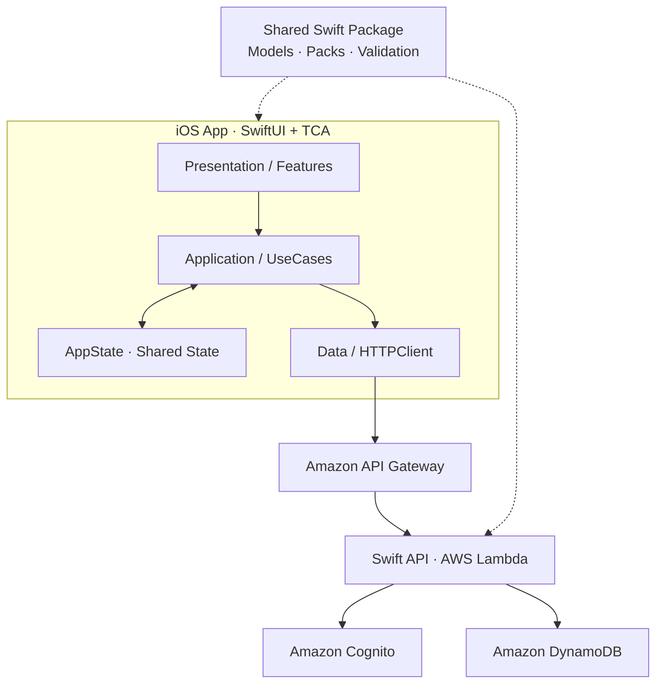

<div align="center">

# 🏮 MaTool

### 祭りの「いま」を、地図でつなぐ。

掛川祭の屋台（山車）の現在位置や行動経路、町・祭典の情報を確認できる iOS アプリ。

[](Shared/Package.swift)
[](iOSApp/)
[](iOSApp/)
[](docs/README.md)
[](Backend/)

**[機能](#-主な機能) · [システム構成](#-システム構成) · [セットアップ](#-クイックスタート) · [開発ガイド](docs/README.md)**

</div>

> [!NOTE]
> 掛川祭における「屋台」は祭りの**山車**を指します。飲食物を販売する屋台の情報を扱うアプリではありません。

## ✨ 主な機能

| | 機能 | 概要 |
| :---: | --- | --- |
| 📍 | **屋台の現在位置** | 各町の屋台の位置を地図から確認 |
| 🗺️ | **行動経路** | 町ごとのルート・通過地点を閲覧 |
| 🏮 | **祭典・町の情報** | 祭典や参加町の情報を参照 |
| 🗓️ | **祭典の期間** | 開催期間や日程に紐づく情報を管理 |
| 🔐 | **管理者向け機能** | 認証・権限に応じて町やルート、位置情報を更新 |

> 公開されるルートや位置情報は権限・公開設定・開催時間帯によって異なります。

## 🧩 システム構成



**iOS** は SwiftUI と The Composable Architecture（TCA）を使用し、UseCase を介して実行時状態 `AppState` を更新します。**Backend** は Swift によるレイヤードアーキテクチャで、API Gateway / Lambda 上で動作します。両者は **Shared** のモデル・通信データ型・検証ロジックを共用します。

## 🛠️ 技術スタック

| 領域 | 技術・構成 |
| --- | --- |
| iOS UI / State | SwiftUI、The Composable Architecture（TCA） |
| アーキテクチャ | Clean Architecture、SSOT、swift-dependencies |
| Backend | Swift、AWS Lambda、API Gateway |
| 認証 / データ保存 | Amazon Cognito、DynamoDB |
| 共通コード | Swift Package Manager、Swift 6.2 |
| テスト | Swift Testing |
| CI / 配布 | GitHub Actions、Xcode Cloud |

## 📁 リポジトリ

```text
MaTool/
├── iOSApp/               # iOS アプリ（SwiftUI / TCA）
├── Backend/              # Swift API / AWS Lambda
├── Shared/               # 共通モデル・Pack・検証
├── MaTool.xcworkspace/   # Xcode ワークスペース
├── docs/                 # 詳細な開発ガイド
├── .github/workflows/    # CI / デプロイ
└── ci_scripts/           # Xcode Cloud 設定生成
```

## 🚀 クイックスタート

### iOS

1. Xcode で `MaTool.xcworkspace` を開きます。
2. API やリンク先に必要な環境変数を設定します。

   ```bash
   export MATOOL_API_BASE_URL="https://<your-api-endpoint>"
   export MATOOL_USER_GUIDE_URL="https://<your-guide-url>"
   export MATOOL_CONTACT_URL="https://<your-contact-url>"
   ./.github/scripts/generate_ios_xcconfig.sh
   ```

3. 利用する環境の `iOSApp/amplifyconfiguration.json` を配置します（形式は `amplifyconfiguration.example.json` を参照）。
4. `iOSApp` スキームを選んで iPhone シミュレータまたは実機でビルドします。

**対応 OS:** iOS 17.0 以降（リポジトリの現行設定）。生成した設定や認証情報はコミットしないでください。

### Backend

`Backend/` に Swift Package があり、AWS Lambda 向け API を実装しています。Cognito 関連の環境変数 `COGNITO_USER_POOL_ID`・`COGNITO_TEST_EMAIL` および `Backend/.env` の設定が必要です。実環境にアクセスする際は AWS 認証・適切な権限も必要になります。

環境構築、API 一覧、権限・公開範囲、検証手順は **[開発ガイド](docs/README.md)** にまとめています。

## 🧪 テストと開発フロー

| 対象 | テスト |
| --- | --- |
| iOS アプリ | `iOSAppTests` / `iOSApp.xctestplan` |
| Backend | `BackendTests` / `BackendTests.xctestplan` |
| Shared | `SharedTests` / `SharedTests.xctestplan` |

テストには **Swift Testing** を採用しています。変更パスに応じて GitHub Actions の検証が走り、配布・デプロイ用のワークフローも用意しています。

### 📚 ドキュメント

- **[開発ガイド](docs/README.md)** — 構成、データフロー、モデル、API、環境設定、テスト、CI・配布
- **[エージェントルール](AGENTS.md)** — 設計原則、実装・検証ルール、ブランチ・PR 運用

---

<div align="center"><sub>地域の祭りを、もっと身近に。🏮</sub></div>
