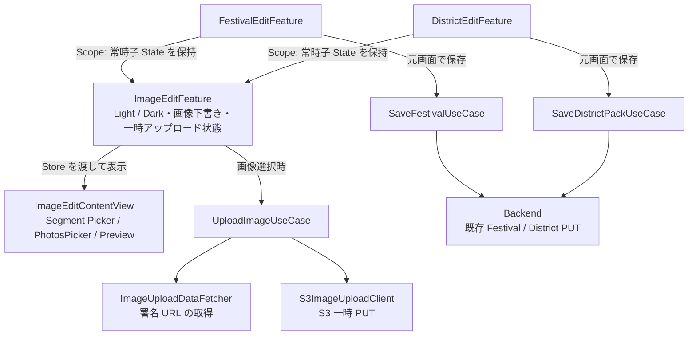

# Festival / District 紹介画像 — iOS 詳細設計

- 対象: `iOSApp` の Festival / District 管理者向け編集画面
- 上位仕様: [spec.md](./spec.md)（PR #380 でマージ済み）
- 本書の目的: **画像選択時に S3 一時アップロードし、元の編集画面で「保存」を押したときだけ正式反映**する iOS の画面・状態・通信設計を確定する
- 本 PR は設計書のみ。コード・画像・AWS 設定は変更しない

## 1. UX / 画面構成

### 1.1 Festival / District の既存編集画面

- `FestivalEditContentView` と `DistrictEditContentView` に「紹介画像」の項目を追加し、**「画像を変更」**ボタンでシートを開く。
- 既存の祭典名／町名、紹介文、所在地、交差点、余興などの編集欄や画面遷移は維持する。管理者の権限境界も変更しない。
- 編集画面に既存の「保存」・「キャンセル」を残す。**正式反映は編集画面の「保存」時のみ**。
- Light / Dark の選択や S3 一時アップロードの有無にかかわらず、編集画面の保存操作は従来の `FestivalPack` / `DistrictPack` PUT を使用する。

### 1.2 画像編集シート

`ImageEditSheet`（仮称）を `NavigationStack` を持つ `.sheet` として表示する。Festival / District で同じ内容を共用する。

1. **上部:** `Picker` を `.segmented`、`.controlSize(.large)` として表示し、`.safeAreaInset(edge: .top)` に固定する。選択肢は **「ライト」「ダーク」**。既存 `RouteEditView.tab` の `safeAreaInset` 配置、本文／選択状態別フォントを基準にする。
2. **中央:** 選択中のモードの画像プレビュー。未変更なら既存 `ImagePath.light/dark` の公開 URL、アップロード済みなら選択したローカル JPEG プレビューを表示する。未設定または参照解除予定ならプレースホルダー。
3. **下部:** 画像がなければ **「画像を追加」**、画像があれば **「画像を変更」**を表示し、`PhotosPicker` を開く。既存画像があり、現在のモードでアップロード失敗がない場合は「画像を削除」も用意し、削除は最終 PUT での `nil` による**参照解除のみ**。削除アイコンも赤色で表示する。
4. **右上:** **「完了」**ボタン。**シートを閉じても画像の編集結果（S3 アップロード済みの一時キーを含む）は元の編集画面に保持**する。タイトル表示モードは inline とする。シートには独立した「確定」「保存」ボタンは設けない。
5. シートを開き直すと直前のライト／ダークの選択・プレビュー・保留状態を再表示する。モードを切り替えても他方の編集内容は失われない。
6. 画像アップロード中は選択操作の重複と閉じる操作を抑制し、進捗を表示する。失敗した場合は選択した画像の下書きを破棄し、既存画像があれば元の画像へ戻す。新規追加なら空状態へ戻し、エラーだけ表示する。再試行・削除ボタンは出さず、再度選択し直せるようにする。

`PhotosPicker` のキャンセルは画像変更なし。既存の画像が片方しかない場合も、**各モードを独立して編集**する。公開画面の「片方がない場合は他方へフォールバック」と、編集画面の「各モードに実在する画像を表示」は区別する。

### 1.3 重要な2段階確定

| 操作 | S3 一時オブジェクト | Backend 本番 Entity / 公開画像 |
| --- | --- | --- |
| シートを開く・ライト／ダークを切替 | 変更なし | 変更なし |
| **PhotosPicker で画像を選択** | **その場で署名 URL を取得し、直接 PUT** | **変更なし** |
| 選択した画像の一時 PUT が成功 | 一時キーを編集 State に保留 | 変更なし |
| シート右上「完了」 | **一時キー・プレビューを保持** | 変更なし |
| 元の編集画面で「保存」 | **新たな一時 PUT は原則しない** | **既存 Pack PUT で正式反映** |
| 元の編集画面で「キャンセル」 | ローカル下書きを破棄。一時 S3 オブジェクトは Lifecycle で消える | 変更なし |

**上位仕様との変更点:** 旧 `spec.md` §6 にある「選択だけでは S3 に送信せず、保存時に初めてアップロード」は廃止し、本書の**選択時アップロード／編集画面保存時確定**を採用する。上位仕様の §6 も本 PR で合わせて改訂する。

## 2. TCA 状態と責務

### 2.1 編集 State が下書きの正本

**共通の `ImageEditFeature.State` が Light / Dark の編集状態と一時アップロードの進行状態を所有**する。`FestivalEditFeature.State` / `DistrictEditFeature.State` はそれぞれ `imageEdit: ImageEditFeature.State` を**通常の子 State として保持**し、親自身にライト／ダーク別の編集ロジックを重複実装しない。**シートの表示状態を消しても子 State を破棄しないため、下書きは残る**。

| 状態（概念） | 意味 | 最終 PUT への変換 |
| --- | --- | --- |
| `unchanged` | 当初の公開 URL を保持 | 既存 `ImagePath` の値 |
| `uploading(localPreview)` | 選択直後、一時 S3 PUT 中 | 保存不可（未確定の一時キーを送らない） |
| `replace(temporaryPath, localPreview)` | S3 一時 PUT 完了、正式反映待ち | 対象 variant の `temporaryPath` |
| `failed` | アップロードに失敗 | 画像下書きを破棄し、元画像を保持。新規追加なら空状態 |
| `remove` | 当該 variant の参照解除を保留 | `nil` |

これは実装モデルの**概念**であり、同等の Equatable/Sendable な State へ簡潔にまとめてよい。`ImageEditFeature` が選択モード `light/dark` と各モードの下書き・アップロード状態を扱う。**シートの表示／非表示だけは親 Feature が管理**する。画像用の永続 Entity や二重の Shared 状態は作らない。

- 既存 `festival.image` / `district.image` は正式保存されるまで変更しない。**未保存の一時キーを `AppState` に書かない**。
- シートの `PhotosPickerItem` は View 側の一時選択値。生の `UIImage` や PhotosPicker の寿命が短いファイル URL を TCA State に保持しない。
- `loadTransferable` 直後にアプリ管理の一時ファイルへコピーするか、安全に所有したデータから JPEG を生成する。完了後はその JPEG をプレビューとアップロードに使用する。元の FileRepresentation の一時 URL を使い続けない。
- ローカル一時ファイルは選択し直した際の旧画像、画像削除、編集画面キャンセル、保存成功、編集 Feature の破棄時に片付ける。**シートの「完了」では片付けない**。アップロード失敗時は選択画像の下書きを破棄する。
- 同じ variant の連続選択は固定 S3 一時キーを上書きするため、選択・通信を直列化して古い完了が新しい下書きを上書きしないようにする。不要な汎用ジョブ管理は作らない。

### 2.2 Feature 間の関係

Festival / District に依存しない **`ImageEditFeature` を共通の子 Reducer** とし、TCA の `Scope` で親に組み込む。シートを閉じても子 State は残すため、`@Presents` / `ifLet` のような「シート終了 = 子 State 破棄」の構成にしない。

**親 Feature の責務:** 「画像を変更」ボタンによるシート開閉、他の編集項目との整合、元画面の保存／キャンセル、既存 SaveUseCase の呼び出し。子 State が持つ変更結果から `ImagePath` を構築して渡す。親が画像の署名取得・S3 アップロードを直接実装しない。

**`ImageEditFeature` の責務:** Light / Dark の切替、既存画像・プレビューの選択、追加／変更／参照解除、画像選択直後の `UploadImageUseCase` 呼び出し、一時パス・失敗時の元画像復元・ローカルファイル掃除。Festival / District 固有の保存処理は持たない。

**State の寿命:** 親 State の `imageEdit` は画面開始時に対象種別・ID・現在の `ImagePath` から初期化し、`.sheet(isPresented:)` による表示切替でも同じインスタンスを使用する。シートの「完了」は親の表示フラグを閉じるだけで、子 State を `nil` にしない。元画面の保存成功・キャンセル・画面破棄時に子 Feature の編集リソースを掃除する。古いアップロード完了が後から別の選択を上書きしないようにする。

### 2.3 Feature / View の配置

| ファイル | 変更内容 |
| --- | --- |
| `Presentation/View/Admin/Region/Edit/FestivalEditFeature.swift` | `ImageEditFeature.State` を保持して `Scope`、シート開閉・既存 Festival 保存 |
| `Presentation/View/Admin/Region/Edit/FestivalEditView.swift` | 「画像を変更」ボタンと、子 Store を渡すシートを ContentView 側に構成 |
| `Presentation/View/Admin/District/Edit/DistrictEditFeature.swift` | 同じ子 Feature を `Scope`、シート開閉・既存 District 保存 |
| `Presentation/View/Admin/District/Edit/DistrictEditView.swift` | 同じ共通シートを表示 |
| 新規 `ImageEditFeature.swift` | **Light / Dark の全編集ロジックと S3 仮アップロード状態を共通化** |
| 新規 `ImageEditContentView.swift` | `safeAreaInset` のセグメント Picker、プレビュー、追加／変更／削除、`PhotosPicker`、右上「完了」。子 Store の状態を描画し Action を送る |
| `Application/UploadImageUseCase.swift`（名称案） | 署名 URL 取得 → S3 一時 PUT の順序を共通化 |
| `Data/Fetcher/ImageUploadDataFetcher.swift` / `Data/Client/S3ImageUploadClient.swift`（名称案） | API で署名 URL を取得／認証ヘッダーを付けず S3 直接 PUT |

既存ルールに従い、**ツールバーやシートの UI 構成は ContentView 側に置く**。`FestivalEditScreen` / `DistrictEditScreen` は Store を接続する薄いコンテナーとし、画面固有の画像管理ロジックをコピー＆ペーストしない。

## 3. Application / Data 層の処理

### 3.1 画像選択時に S3 一時アップロード

1. PhotosPicker の JPEG / PNG などの画像を読み込み、アプリ管理のローカル JPEG に変換・圧縮する。Client と Backend で合意した画素数・バイト数制限を守る（値を独自に決めない）。
2. 共通 `POST /images/upload-url` を、**既存の認証付き `HTTPClient`** から呼び出す。Shared 側の `ImageUploadURLRequest` / `ImageUploadURLResponse` / `ImageUploadTarget` をそのまま使用。Festival / District それぞれの ID と `light/dark` を指定。
3. 応答の `url` に向けて、**Backend API Client と別の S3 直接 PUT 用 Data Client**（名称案 `S3ImageUploadClient`）が `image/jpeg` を送信。S3 には Cognito の Bearer token を送らず、署名に必要なヘッダーだけを一致させる。
4. S3 の HTTP 2xx を確認してから、応答の `path` を該当 variant の `replace(temporaryPath, localPreview)` として確定する。
5. **この時点では Festival / District の既存 PUT を呼び出さない**。公開画面・`AppState` の URL は変わらない。

署名の期限切れ、通信失敗、画像変換失敗、S3 の異常ステータスはエラーとして扱い、選択画像の下書きを破棄して元の画像状態に戻す。ユーザーは再度 `PhotosPicker` から画像を選べる。必要なヘッダーが `ImageUploadURLResponse` だけでは判別できない場合は、Backend の共通契約で固定する（新たな独自 API を生やさない）。

### 3.2 元の編集画面の「保存」時

1. 既存の文字項目等の検証を実施。いずれかの画像が `uploading` なら、**正式 PUT しない**で状態を説明する。失敗した選択は画像状態から破棄され、元画像へ戻る。
2. `festival.image` または `district.image` の**既存現在値**に、ライト／ダークの下書きを variant ごとに適用し、新しい `ImagePath(light:dark:)` を構築する。変更なしは既存公開 URL、差し替えは S3 一時キー、削除は `nil`。
3. **既存の** `SaveFestivalUseCase` / `SaveDistrictPackUseCase` → `FestivalDataFetcher.update` / `DistrictDataFetcher.update` を使い、これまでどおり Pack を PUT する。署名 URL 取得や S3 一時 PUT をこの時点で繰り返さない。
4. Backend が返した正式公開 URL（差し替えごとに異なる `?v=` を含む）を、既存 Usecase が現在の `sessionId` と Festival/District ID を検査して `AppState` に適用。**レスポンス値だけ**を正本とし、下書きの `temporaryPath` を AppState に流入させない。
5. 成功したらローカル下書きを掃除して編集画面を閉じる。保存失敗時は画面を開いたままにし、既存の保存失敗時の挙動に従う。S3/DB 非原子的な失敗の際は必要なら現在の Pack を再取得してから再度保存する。

既存 `SaveFestivalUseCase` / `SaveDistrictPackUseCase` の `appState.withLock` による `sessionId` ガードと、`saveTapped` 後の二重送信抑止を維持。編集途中のログイン／祭典切替や画面破棄では古い結果を別セッションに反映しない。画像確定のために新しい Backend API を増やさない。

**責務の配置:** 署名 URL の取得は `ImageUploadDataFetcher` 等の Data/Fetcher、S3 PUT は Data/Client、画像変換・アップロード調停は `UploadImageUseCase`、ライト／ダークの編集と下書きから `ImagePath` への合成は **`ImageEditFeature.State` の共通処理**、シート表示と既存の最終保存は親 Feature に置く。両親の SaveUseCase に同じ下書き合成ロジックを重複実装しない。不要な独立 Repository や汎用アップロードフレームワークは作らない。

## 4. キャッシュと公開画面

- 現行 `InfoHeaderImageView` / `InfoImageBlurredBackgroundView` が行う colorScheme によるフォールバックは維持する。
- `WebImageView` の Kingfisher / `ImageCacheClient` は URL をキーとする。**Backend が更新ごとに新しい公開 URL を返す**既存契約に従い、新 URL が AppState に適用された後に表示・preload する。手動で全キャッシュを消す処理を標準にはしない。
- シート内の未確定画像は S3 非公開一時キーを `WebImageView` に渡さず、**所有するローカル JPEG**でプレビューする。
- CDN における `?v=` のキャッシュ分離と公開 GET → CDN GET は Backend / AWS の結合確認項目であり、iOS 側でも新 URL を使うことを確認する。

## 5. テスト仕様（Swift Testing）

| ID | 観点 | 必須確認 |
| --- | --- | --- |
| I01 | 見た目 | 既存 Festival / District 編集画面から「画像を変更」でシート表示。inline タイトル、上部 `safeAreaInset` のライト／ダーク segmented Picker、プレビュー、画像追加／変更、「完了」を確認 |
| I02 | 初期状態 | 各モードの画像の有無で「画像を追加」「画像を変更」が変わる。プレビューは各モードの実際の画像（公開画面の代替表示とは別） |
| I03 | 選択直後 | `PhotosPicker` 選択 → JPEG 化 → 共通署名 URL POST → S3 直接 PUT → 一時キー保留の順序。**編集画面の「保存」前にアップロードするが、Pack PUT は0回** |
| I04 | シート閉じる | ライト／ダーク各自の変更は「完了」後・シート再表示後も維持。未保存の `AppState` と公開画像は変わらない |
| I05 | 正式保存 | 変更した方の一時キー＋未変更側の公開 URL／削除した方の nil で**既存 Pack PUT を1回**だけ呼ぶ。Save Usecase が Backend 正式 URL を AppState へ適用。保存時の一時 S3 再 PUT は0回 |
| I06 | キャンセル | シートを閉じるだけでは保留を破棄せず、**元の編集画面のキャンセル**では正式 PUT をせずローカルファイルを掃除 |
| I07 | 失敗 | 署名取得失敗・S3 PUT 失敗・画像変換失敗は選択画像を破棄し、既存画像または空状態に戻してエラー表示。再試行・削除ボタンは出さず、再選択を可能にする。Pack PUT 失敗なら一時キーとプレビューを残して再保存可。二重タップや遅延完了による上書き防止 |
| I08 | ファイル寿命 | PhotosPicker 選択から時間経過・別項目編集・シート閉じ／再表示後にもプレビューを維持。成功・キャンセル・失敗・再選択・破棄で適切に掃除 |
| I09 | セッション | 別祭典・ログイン切替後、旧画像の遅延 PUT／保存応答で別 `AppState` を汚染しない |
| I10 | 互換・表示 | 無変更なら署名 URL POST / S3 PUT なし。Light/Dark 切替、片方のみ、両方なし、差し替え後の新 URL を Kingfisher が取得。公開 GET → CDN GET の新画像は結合確認 |

- 共通の `ImageEditFeatureTests` で Light / Dark 切替・選択時 S3 一時 PUT・削除・失敗時の元画像復元・通信完了順序・シートを閉じた後の State 保持を集中検証し、親 `FestivalEditFeatureTests` / `DistrictEditFeatureTests` は `Scope`・シート開閉・最終保存への受け渡しを検証する。画像送信用 Client と保存 Usecase の Spy は **`iOSApp/Tests/Utility/`** に置き、テスト専用 Mock / Spy を Sources に含めない。
- 共通画像処理は追加したソースと1対1で対応する Swift Testing テストを設ける。依存関係の `testValue` 未設定や Live Client の誤呼出を残さない。
- UI の見た目と遷移は AGENTS.md に従ってシミュレータ上で実際にシート・追加・ライト／ダーク切替・閉じる・保存を操作し、スクリーンショットと画面状態を確認する。実環境の S3/Backend がなければ Spy で画面経路を検証し、実通信未検証を明記する。

## 6. 対象外

Store 広告画像、IAP、Backend の新 API、S3 バケット・CDN 設定、画像 UUID、アップロード確定専用 API、ETag/Versioning、画像の物理削除、公開画面の大規模変更。

**実装順:** 共通アップロード Data Client / Application 処理 → `ImageEditFeature` + `ImageEditContentView` → Festival / District 親 Feature の `Scope` 連携 → 既存 SaveUseCase との統合 → テスト・画面動作確認。Backend 側の API と署名付き PUT ヘッダーの契約を事前に確認し、iOS 独自の DTO を増やさない。
