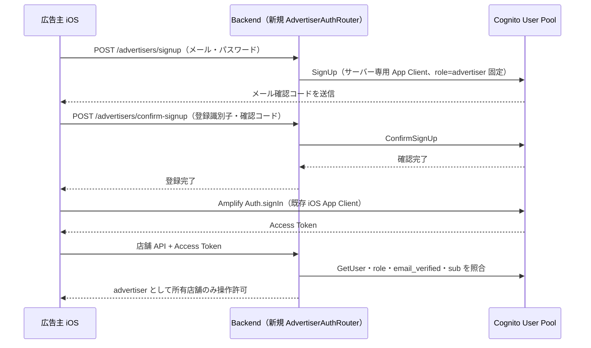
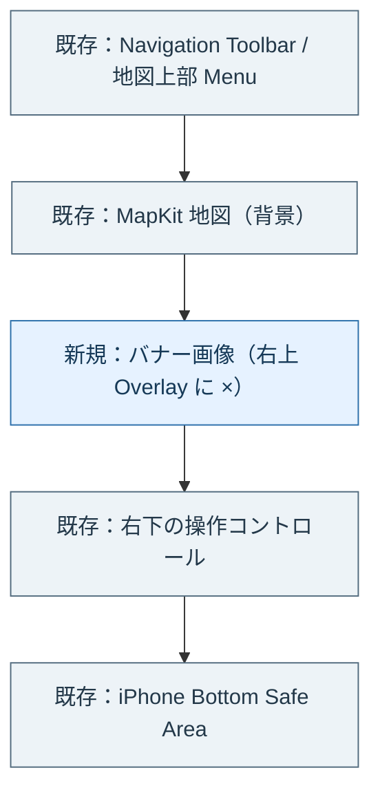
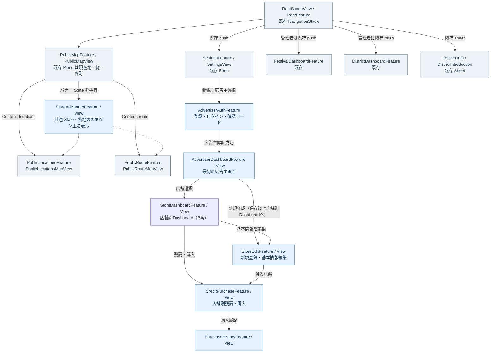
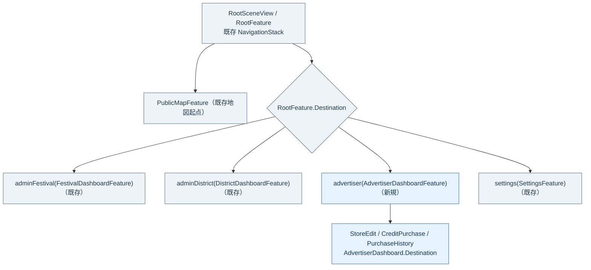
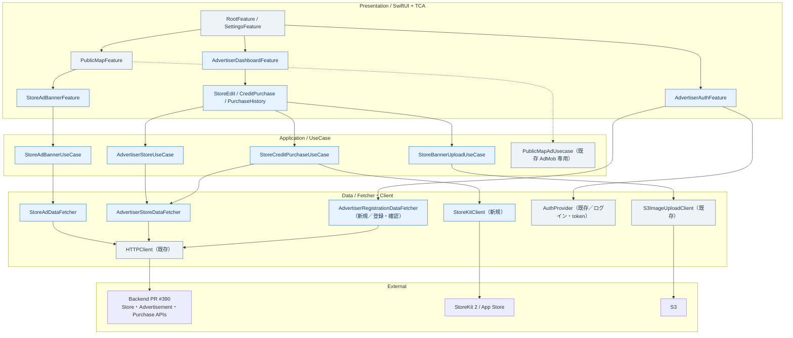
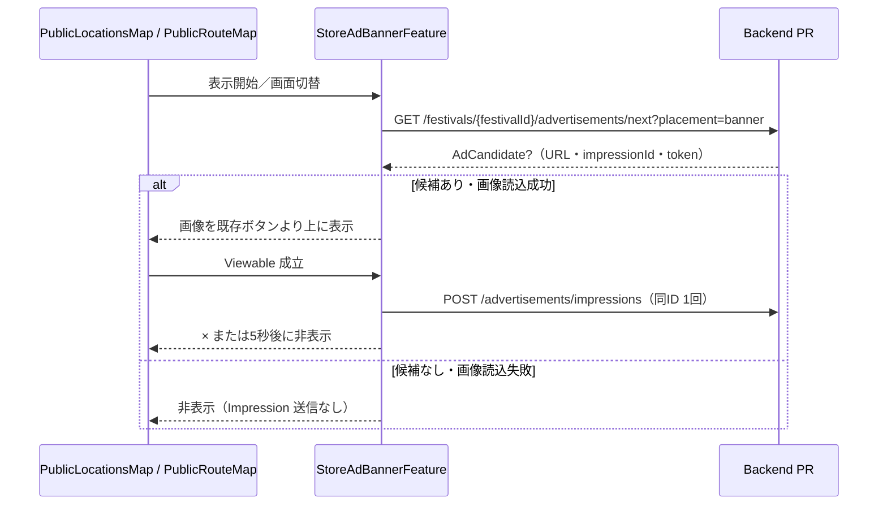

# MaTool 独自広告 iOS 設計 — 第一段階

- **状態**: 設計案・実装前（レビュー用）
- **対象**: `iOSApp`（SwiftUI / TCA / swift-dependencies / StoreKit 2）
- **参照**: [独自広告仕様](./spec.md) / [Backend 設計](./backend.md) / [Backend 実装 PR #390](https://github.com/kmatsushita1012/MaTool/pull/390)
- **続編**: [第二段階の設計（店舗地図・店舗詳細・全画面広告）](./ios-phase2.md)
- **採用済み店舗管理UX**: [店舗別 Dashboard B案](./store-dashboard-ux.md)（このファイル中の旧ワイヤーフレームに優先。**店舗選択→店舗別Dashboard／新規保存後→新しい店舗のDashboard**）
- **既存実装の確認基準**: `main` の [`faf56f5`](https://github.com/kmatsushita1012/MaTool/commit/faf56f5662162cf8ffcfde23ce1a87a85be2f8c7)
- **由来**: 合意済み HTML ワイヤーフレーム v0.4 を GitHub 上でレビューできる Markdown／Mermaid に移植
- **注意**: 以下の「新規」は**設計案**であり、Swift 実装済みではない

## 1. 第一段階のスコープ

「店舗画面」は**一般来場者向けの公開店舗地図／店舗詳細**を指す。一方、**広告主が自店舗を作成・編集する管理画面**は第一段階に含める。両者を混同しない。

| 機能 | 第一段階 | 説明 |
| --- | --- | --- |
| 広告主登録・ログイン／メール確認 | **実装する** | **登録・メール確認は Backend API 経由**。ログインは既存 Amplify / Cognito を利用。Role は Backend が固定付与 |
| `AdvertiserDashboard` | **実装する** | 広告主向けの最初の管理画面 |
| 所有店舗一覧・店舗作成／編集 | **実装する** | 住所、営業時間、説明、位置座標、広告配信の一時停止 |
| **バナー**画像の選択／入稿 | **実装する** | `PhotosPicker` → S3 → Store PUT |
| Credit 残高・購入・購入履歴 | **実装する** | 店舗別、StoreKit 2、500pt／1,000pt |
| `PublicLocationsMapView` の独自バナー | **実装する** | 地図下部の既存操作ボタン**より上** |
| `PublicRouteMapView` の独自バナー | **実装する** | 同じ配置規則。既存リプレイ／日程を維持 |
| 地図の `.stores` モード、公開店舗ピン | **第二段階** | 第一段階では `Menu` の項目を追加しない |
| 一般利用者向け店舗詳細 | **第二段階** | バナータップでの詳細遷移も第一段階では実装しない |
| 独自全画面広告・全画面画像入稿 UI | **第二段階** | 全画面候補取得・表示・画像編集 UI を追加しない |

### 1.1 既存 UI を変更しない範囲

- 地図左上のコンテンツ切替は **`Picker` ではなく、現行の `Menu`**。`.locations`（現在地一覧）と `.route(districtId)`（各町）を引き続き使用する。
- 上部の祭典名、「祭紹介／町紹介」、設定／管理者メニューを変えない。町画面の日程 `Menu` を残す。
- 現在地一覧の右下コントロールは**現在地・町位置選択・更新**、町画面の右下は**現在地・山車位置・リプレイ**。位置・順序・操作・Liquid Glass の分岐を維持する。
- 経路地点の `PointView` 内に存在する `PublicMapBannerAdSection` は**既存 AdMob 部品**。今回の地図下部の独自バナーとは区別する。
- Festival／District 管理者の既存 Dashboard、および既存 `SettingsView`・管理者ログインを置き換えない。

## 2. 広告主管理画面はシステム標準 Form を優先

**最初の画面は `AdvertiserDashboardFeature` / `AdvertiserDashboardView` とする。** 既存の `FestivalDashboardFeature/View`、`DistrictDashboardFeature/View` と**命名・TCA Reducer／State／Destination／Screen と ContentView の構成を合わせる**。独立したルート `NavigationStack` を作らず、Root の既存ナビゲーションに統合する。

表示内容は原則 `Form` / `Section` / `List` / `TextField` / `TextEditor` / `Toggle` / `PhotosPicker` / `NavigationLink` / `Button` で組む。独自カード、装飾的ダッシュボード、独自フォームコンポーネントは作らない。

カスタム UI は以下のみ許容する。
- **新規独自広告バナー**（画像と小さな ×）
- **画像プレビュー**（選択した写真を見せるための最小限）
- **店舗座標の選択 UI**（標準 MapKit／SwiftUI で足りない最小限のみ）

### 2.1 画面ワイヤーフレーム（情報配置の模式図）

以下は**画面の情報の順序**を示す。行間・角丸・背景・見た目は iOS 標準 `Form` に任せ、独自スタイルとして固定しない。

#### A. 広告主管理トップ — `AdvertiserDashboardView`

```text
┌─────────────────────────────────────┐
│ ‹ 戻る              店舗管理        │
├─────────────────────────────────────┤
│ ［Form / Section: 所有店舗］         │
│   ○○商店             公開中   ›     │
│   △△カフェ           掲載停止 ›     │
│   ＋ 店舗を追加                      │
│                                     │
│ ［Form / Section: アカウント］       │
│   アカウント情報              ›     │
│   ログアウト                        │
└─────────────────────────────────────┘
```

- 所有店舗ごとに編集へ push。Credit 購入／残高は**その店舗に紐付く**画面からアクセスする。
- Dashboard はナビゲーションのハブ。Festival／District 既存 Dashboard と同様に TCA `Destination` を持つ。

#### B. 店舗作成・編集 — `StoreEditView`

```text
┌─────────────────────────────────────┐
│ ‹ 戻る              店舗編集        │
├─────────────────────────────────────┤
│ ［基本情報］                        │
│   店名           ○○商店             │
│   住所           静岡県掛川市…      │
│   営業時間       10:00〜19:00       │
│   説明           テキストを編集  ›  │
│                                     │
│ ［位置］                            │
│   地図で指定                    ›   │
│                                     │
│ ［広告］                            │
│   バナー画像      写真を選択        │
│   広告配信を一時停止         [ON/OFF]│
│                                     │
│            ［保存］                 │
└─────────────────────────────────────┘
```

- 新規: `POST /festivals/:festivalId/stores` → 返された Store を表示／編集の正本にする。
- 編集: `PUT /stores/:storeId`。`bannerImagePath` は一時パス・正式 URL・明示 `null` を適切に送る。
- **全画面画像の行は表示しない。** Backend の Store PUT は全体を受けるため、**変更していない `interstitialImagePath` は既存値を維持して送信**する。
- Save 成功時に**Backend レスポンスの Store**を採用。画面で推測した正式画像 URL や状態を採用しない。

#### C. Credit — `CreditPurchaseView`

```text
┌─────────────────────────────────────┐
│ ‹ 戻る             クレジット       │
├─────────────────────────────────────┤
│ ［残高］                            │
│   利用可能              1,220pt     │
│                                     │
│ ［クレジット購入］                  │
│   500pt                  ¥500   ›  │
│   1,000pt              ¥1,000   ›  │
│   ※名称と価格は StoreKit から取得  │
│                                     │
│ ［購入情報］                        │
│   購入履歴                      ›   │
│                                     │
│ バナー表示：1pt 消費                │
└─────────────────────────────────────┘
```

- `Product.displayName` / `description` / `displayPrice` を使う。商品名・価格を iOS に二重ハードコードしない。
- `Product.purchase(options: [.appAccountToken(store.purchaseAccountToken)])` で購入し、署名済み取引を Backend `POST /stores/:storeId/purchases` に Claim した**後に** `finish()`。
- 復旧時の取引再送は Backend の冪等性に依存。Credit は店舗単位で、祭典年度には依存しない。

#### D. 購入履歴 — `PurchaseHistoryView`

```text
┌─────────────────────────────────────┐
│ ‹ 戻る              購入履歴        │
├─────────────────────────────────────┤
│ ［履歴］                            │
│   2026/11/07  500pt       ¥500      │
│   2026/11/02  1,000pt   ¥1,000      │
│   2026/10/25  500pt       ¥500      │
└─────────────────────────────────────┘
```

- 読み取り専用の標準 List / Form。`GET /stores/:storeId/purchases` から取得。
- 図中の日付・残高・価格は**レイアウト用の例**。実際の金額表示は StoreKit／API の値で決定する。

#### E. 広告主認証 — `AdvertiserAuthFeature`

```text
┌─────────────────────────────────────┐
│ ‹ 戻る            広告主ログイン    │
├─────────────────────────────────────┤
│ ［ログイン］                        │
│   メール      name@example.com     │
│   パスワード  ••••••••••••         │
│            ［ログイン］             │
│                                     │
│ ［はじめての方］                    │
│   広告主アカウントを作成        ›   │
│   → 登録後、確認コード入力          │
└─────────────────────────────────────┘
```

- **広告主登録は iOS → Backend → Cognito**。iOS は `POST /advertisers/signup` にメール／パスワードを送信し、続く `POST /advertisers/confirm-signup` に確認コードを送信する。iOS から Cognito `SignUp` / `ConfirmSignUp` を直接呼ばない。
- Backend はサーバー専用（秘密鍵付き）Cognito App Client の `SignUp` で **`custom:role=advertiser` を固定指定**。この登録 API はユーザーから role を受け取らない。Cognito の通常ユーザー向け App Client は `custom:role` の**読み取りのみ可・書き込み不可**。
- メール確認後に iOS の**既存 Amplify `SignIn`**へ進み、Backend は Access Token を検証して `.advertiser(sub)` と解釈する。
- 既存の町／祭典管理者の Login UI・権限を流用して変更しない。認証依存の共有はよいが、**画面遷移とロールの判定を混同しない**。

## 2.2 広告主の登録経路と権限制御（Backend 経由を必須とする）



1. 新規 Backend API：`POST /advertisers/signup`（未認証）。**クライアント入力はメールアドレス・パスワードのみ**。Backend 側で検証し、専用 Cognito App Client の `SignUp` に `custom:role=advertiser` を固定して送る。ユーザーが指定した role / sub / ownerId は一切受理しない。
2. 同 `POST /advertisers/confirm-signup`（未認証）で確認コードを Cognito `ConfirmSignUp` に渡す。登録の確認先は Cognito 標準メール検証。登録用アプリクライアントは**Backend 専用・Client Secret あり**とし、Secret と SECRET_HASH を iOS に渡さない。
3. Cognito の iOS 通常 App Client は `custom:role` の**Read は許可、Write は禁止**。Backend 専用登録 App Client だけが SignUp 時に書き込み可能。User Pool のメールサインイン／Username 設定がこの方式に対応するかインフラ構成を確認する。
4. ログイン／トークン更新は既存の `Amplify.Auth.signIn` / `fetchAuthSession` を使用し、Backend が `email_verified=true`、`custom:role=advertiser`、`sub` の存在を検証。**role 未設定を自動で広告主とみなさない**。既存の未設定ユーザーがいる場合は移行対象を確認する。
5. Backend 登録 API は公開エンドポイントなので**レート制限、Cognito エラー／重複登録／コード期限切れ、ログにパスワードを残さない設定**を受入条件とする。ログイン前に Festival／District の管理 API を操作できないこと。
6. 店舗作成時の `ownerId` は**Backend が検証済み Cognito sub から決める**。端末が送った role 等で管理者に昇格しないことをテストする。

**Backend #390 の現状**：上記の登録・確認 API はまだない。現行 `CognitoAuthManager.parseUserRole` は `custom:role` が `nil` でメール確認済みなら advertiser と解釈するため、実装時には明示 role のみに変更する必要がある。第一段階を実装する前の **Backend 側の追加作業**として扱う。既存管理者の `AdminCreateUser`（一時パスワード通知）を流用せず、通常のメール確認付きセルフ登録を維持する。

## 3. 地図バナーのレイアウト

**第一段階で独自バナーを出す場所は `PublicLocationsMapView` と `PublicRouteMapView` の2つだけ**。既存の全面地図と右下ボタン群の**間の下部領域**に置く。

### 3.1 現在地一覧（既存 + 新規差分）

```text
┌────────────────────────────────────────┐
│ 掛川祭          ［祭紹介］［設定］      │ ← 既存 Navigation Toolbar
│                                        │
│ ［現在地一覧 ▾］                       │ ← 既存左上 Menu
│                                        │
│               MapKit 地図               │
│        （既存の現在地・各町位置）       │
│                                        │
│ ┌────────────────────────────────────┐ │
│ │                                [×] │ │ ← 新規：画像上への小さな Overlay
│ │       画像のみの横長バナー           │ │
│ └────────────────────────────────────┘ │
│                      ［⌖］［町］［↻］ │ ← 既存右下操作ボタン
└────────────────────────────────────────┘
              iPhone Bottom Safe Area
```

- 既存: `MapView(style: .public, floats: ...)`、ボタンは **現在地 → 町位置選択 → 更新**。
- 新規: **バナー画像のみ**をボタンの上に固定。店名・テキスト・CTA は上乗せしない（閉じるアイコンだけ例外）。

### 3.2 各町（既存 + 新規差分）

```text
┌────────────────────────────────────────┐
│ 掛川祭          ［町紹介］［設定］      │ ← 既存 Navigation Toolbar
│                                        │
│ ［町A ▾］ ［1日目・午後 ▾］           │ ← 既存2つの Menu
│                                        │
│               MapKit 地図               │
│         （既存の地点・経路・山車）       │
│                                        │
│ ┌────────────────────────────────────┐ │
│ │                                [×] │ │ ← 新規：画像右上 Overlay
│ │       画像のみの横長バナー           │ │
│ └────────────────────────────────────┘ │
│                 ［⌖］［山車］［▶］   │ ← 既存右下操作ボタン
└────────────────────────────────────────┘
              iPhone Bottom Safe Area
```

- 既存: 日程 Menu、地点 Sheet、山車フォーカス、リプレイ（再生中の Slider を含む）。
- 新規: 同じバナー部品をコントロールの上に置く。**Slider や既存操作と重ならない**。

### 3.3 重要な配置規約



**実装方針**: 既存 `safeAreaInset(edge: .bottom)` と右下コントロールの Liquid Glass / 非 Glass 分岐はそのまま。広告部分を**ボタンの上**に配置し、コントロールを**広告の表示／非表示で上下に動かさない**。バナー非表示時に広告用の空白は残さない。位置合わせのためにベタ書きの固定 offset で既存ボタン群を移動させない。広告領域以外は地図へのタッチを妨げない。

### 3.4 `StoreAdBannerView` の表示・振る舞い

| 項目 | 要件 |
| --- | --- |
| 表示対象 | `.locations` / `.route(districtId)` のみ |
| 内容 | **バナー画像のみ**。店名・ラベル・説明・独自 CTA は追加しない |
| 閉じる | 画像の**右上 Overlay**に小さな `xmark` または `xmark.circle.fill`。外観は小さく、タップ領域・VoiceOver ラベルは確保 |
| 表示時間 | 約5秒で自動的に消す。× を押しても消す |
| 再取得 | 画面の表示／モード切替を契機に次の候補を取得。**5秒ごとの自動ローテーションはしない** |
| 位置 | 地図下部、既存操作ボタン**より上**。表示／消去でボタンが移動しない |
| 画像ロード失敗 | 表示しない。**Impression 報告しない** |
| Viewable | 画像が実表示された時に条件判定。成立後 `POST /advertisements/impressions` を**同じ impressionId につき一度だけ**送る |
| 候補取得 | `GET /festivals/:festivalId/advertisements/next?placement=banner`（全画面候補は取得しない） |
| 画像タップ | 第一段階では**店舗詳細遷移を実装しない**。第二段階で導線追加 |
| 候補なし／閉じた後 | 広告を非表示。地図操作を阻害しない |

**未確定**: 厳密な Viewable 閾値（割合・表示秒数）、画像の高さ／縦横比／容量、在庫なし時の AdMob fallback の詳細。仮の固定値を確定仕様としない。

## 4. Navigation 構成（第一段階）

既存の `RootSceneView` → `RootFeature` の `NavigationStack` と Dashboard push を保つ。公開店舗モードは**第一段階の遷移図に含めない**。



**ロールに関する実装上の注意**

現行 `RootFeature.isAdminLoggedIn` は `userRole != .guest`、`setAdminDestination` は `.headquarter`／`.district`／`.guest` を処理する。`.advertiser` を追加するなら、**「ログイン済み」と「祭典／町管理者」を分離した分岐**が必要。広告主を既存 Admin Dashboard に入れない。起動済みユーザー、ログイン直後、ログアウト時のいずれも適切な画面へ遷移し、既存管理者の動作を保つ。

### 4.1 既存管理者と同じ Navigation Tree 再構築を必須とする

**広告主 Dashboard は既存の Festival／District Dashboard と同じ Root のナビゲーションツリーに属する。** ログイン後に別の `NavigationStack` を重ねたり、View 側の状態フラグだけで画面を差し替えたりしない。**Root Reducer がログイン成功・認証済み起動・ログアウト・祭典／町切替で Navigation Tree を組み直す**設計とする。



| 契機 | Root の State 再構築 | 受入条件 |
| --- | --- | --- |
| **広告主ログイン成功** | `Settings → LoginFeature → RootFeature` の既存成功 Action 経路で `.advertiser(sub)` を受け、`launchState`・`map` を再生成。旧 Settings / Login を破棄して `destination=.advertiser(AdvertiserDashboardFeature.State(...))` を構築 | 古いログイン階層に Dashboard を積み重ねない |
| **Festival／District 管理者のログイン成功** | 従来どおり `adminFestival` / `adminDistrict` へ遷移 | 既存 Dashboard を変えない |
| **アプリ再起動・認証復元** | `launchSceneUseCase` → `RootFeature.launchFinished` で Role と `lastMainScreenUseCase` の記録を照合し、前回 Dashboard なら広告主 Destination を新規生成。前回 Map なら地図に戻る | View の `onAppear` から ad hoc に push しない |
| **Dashboard の戻る操作** | 既存 Dashboard と同様 `destination=nil`、前回画面を `.map` に保存 | ログインセッションを保持 |
| **広告主ログアウト成功** | `finishSignOut` と同様、ゲスト用 `launchState` と `map` を作成し、`destination`・`sheet`・Dashboard 子 Feature・前回画面記録をクリア | StoreEdit／Credit などがナビゲーションに残らない |
| **祭典／町変更** | `updateMapForSceneSelection` の既存流儀で `map` を再構築し、古い祭典に依存する Dashboard 子 State を破棄／必要に応じ再取得 | Credit／所有店舗は年度 `AppState` に混ぜない |
| **未認証・認証失敗** | 既存 Map／Onboarding のみ | 広告主 Dashboard を生成しない |

**具体的なコード設計の指示**

1. `RootFeature.Destination` に `case advertiser(AdvertiserDashboardFeature)` を加え、`RootSceneView` の**既存** `NavigationStack` の `navigationDestination` へ追加する。既存の `adminFestival`／`adminDistrict` は維持。
2. `setAdminDestination` は従来の Festival／District 管理者用に残し、Role ごとに Root が正しい Dashboard を選ぶ分岐へ統合。`launchFinished` と Login 成功の両方が**同じツリー構築規約**を使うようにする。
3. 現行 `RootFeature.isAdminLoggedIn = userRole != .guest` は、広告主も管理者と判定するため**修正必須**。管理者と広告主を区別し、地図の管理者導線から広告主が Festival／District Dashboard に入らないこと。
4. `lastMainScreenUseCase` の既存保存値との互換性を保ち、広告主 Dashboard の復元は Root で行う。保存形式を増やすか既存 `.admin` を「Role に応じた Dashboard」として解釈するかは実装で確認する。深い子画面を勝手に復元しない。
5. **Backend による `confirm-signup` 完了はログイン完了ではない**。その後 Amplify `SignIn` 成功 Action を Root へ伝播させてツリーを切り替える。
6. `AdvertiserDashboardFeature` も `@Reducer`、`@ObservableState`、`@Presents Destination`、`@Presents alert` を持つ。`AdvertiserDashboardScreen` と `AdvertiserDashboardContentView` を分離し、子画面へ `navigationDestination` で push。`Form`・`Section`・`List` を主とする。

**Swift Testing の受入条件**: 広告主 SignIn→Dashboard、新規起動時復元、Dashboard を閉じた後の Map 復帰、ログアウト時の子 State 全破棄、町／祭典変更時の古い State の破棄、既存管理者の回帰、広告主の権限誤昇格拒否。Simulator で既存 Festival／District Dashboard と同じ戻る・ツリー再構築を確認する。

## 5. クラス相関／状態の正本

以下は**新規クラスの提案名**。既存コードへ寄せ、同じ責務の新規インフラを無駄に作らない。



| 状態 | 所有者／正本 | 方針 |
| --- | --- | --- |
| 祭典・町・Route・期間 | 既存の `AppState`（`@Shared`） | 年度セッション単位。既存の仕組みを維持 |
| 現在表示中のバナー | `StoreAdBannerFeature.State` | `PublicMapFeature` が一つ保持して両地図から表示。候補・dismiss・タイマー・表示報告状態を管理 |
| 所有店舗一覧 | `AdvertiserDashboardFeature.State` | Backend の所有店舗 API 応答を正本にし、年度 `AppState` に混ぜない |
| 店舗編集の未保存データ | `StoreEditFeature.State` | 編集途中は一時値。Store PUT 成功後のみ Backend 返却値に更新 |
| 残高・購入履歴 | 店舗別の管理 Feature State | Backend の結果を正本。年度をまたいで維持する情報 |
| 購入の進行状態 | `CreditPurchaseFeature.State` | StoreKit 取引 → Backend Claim → finish 完了まで管理 |

バナーの候補取得・表示・閉じる・タイマーは同一の親 Feature の状態で一元管理する。モード変更時は古い候補取得／表示タスクを cancel し、**前モードの広告が次の地図に残らない**ようにする。既存 `PublicMapAdUsecase` は AdMob のままにして責務を混ぜない。

## 6. API と操作のフロー

### 6.1 バナー表示



- 報告が Backend に受理されないときに**端末で後日請求しない**。
- 広告が消えても既存ボタン位置は不変。5秒ごとの自動再取得はしない。

### 6.2 店舗とバナー画像の登録

1. Dashboard の「店舗を追加」→ `POST /festivals/:festivalId/stores` → Store ID と Store を取得。
2. `StoreEditView` の純正フォームで店名・住所・営業時間・説明・位置・任意停止を編集。
3. `PhotosPicker` で画像選択 → JPEG 化 → `POST /images/upload-url`（`type=store`、`variant=banner`）→ 返された署名 URL で S3 へ直接 PUT。
4. `PUT /stores/:storeId` に**アップロードの一時パス**を `bannerImagePath` として含め、**`interstitialImagePath` は既存値をそのまま維持**する。明示 `null` が必要な場合はキーを省略しない。
5. Backend が返す Store の正式画像 URL（バージョン付き）・状態を採用して Dashboard に反映。

**全画面画像のアップロード UI は作らない**。既存の `S3ImageUploadClient` を可能な限り再利用する。画像は正式保存まで一覧や `AppState` に未確定の一時値を反映しない。

### 6.3 Credit 購入

1. Dashboard → 対象店舗 → Credit 画面。`GET /stores/:storeId/credits` と商品情報を取得。
2. StoreKit 2 Consumable（500pt / 1,000pt）の `Product` を取得し、商品名・価格を表示。
3. `appAccountToken(store.purchaseAccountToken)` を購入オプションに設定して購入。
4. 署名済み取引を `POST /stores/:storeId/purchases` に送って Backend で Claim／Credit 付与。
5. **成功してから `Transaction.finish()`**。残高を再取得。購入履歴は `GET /stores/:storeId/purchases`。

購入直後の通信失敗、アプリ再起動、`Transaction.unfinished` の復旧、同一取引の再送、別 Store の `appAccountToken` 不一致をテストする。

## 7. 受入条件（既存 UI を壊さない）

| 対象 | OK 条件 | 種別 |
| --- | --- | --- |
| 左上モード Menu | `現在地一覧` と実際の町名だけ。第一段階では `.stores` を追加しない | 既存維持 |
| 上部 Toolbar | 祭典名、祭／町紹介、設定／管理者メニューは現行どおり | 既存維持 |
| 町の日程 | 町選択時の日程 Menu と画面上の位置を保持 | 既存維持 |
| 現在地の操作 | 現在地・町位置・更新の順序と動作、既存 Liquid Glass 表現を保持 | 既存維持 |
| 町の操作 | 現在地・山車・リプレイ、Slider、地点 Sheet、Liquid Glass を保持 | 既存維持 |
| **バナーの位置** | **画像は右下ボタンの直上。× は画像の右上。ボタンはバナーの有無で動かない** | 新規 |
| バナー UI | 画像のみ、独自テキスト／CTA なし。小さな閉じるアイコンのタップ領域・VoiceOver を確保 | 新規 |
| バナーライフサイクル | モード切替時に次の候補、5秒または×で閉じる、ローテーションなし、表示失敗なら報告なし、同じ impressionId を重複報告しない | 新規 |
| Dashboard | `AdvertiserDashboardFeature/View` の命名で既存 Festival／District Dashboard と区別 | 新規 |
| Form | Dashboard／店舗編集／Credit／履歴／認証は純正 Form / Section 主体。既存 Settings・管理者ログインを置換しない | 新規 |
| Role | 広告主が Festival／District の Dashboard に入れない。既存管理者は従来の Dashboard に入れる | 必須 |
| 第一段階の境界 | 公開店舗モード・ピン・詳細・独自全画面広告・全画面画像編集 UI を追加しない | 対象外 |
| テスト | Swift Testing で Reducer 遷移／role／timer／cancel／Impression、PhotosPicker→S3→PUT、購入復旧を検証 | 必須 |
| 画面検証 | 実装後は既存 UI と両地図の Simulator 画面を照合。広告表示・非表示でボタン位置が変わらないことをスクリーンショットで確認 | 必須 |

## 8. 未確定・第一段階リリース前に決めること

- **Viewable 閾値**: 可視割合と経過時間、アプリがバックグラウンドになった場合の扱い。
- **バナー画像規格**: 容量・画素数・縦横比・表示高さ。ワイヤーフレームのサイズは正式な規格ではない。
- **在庫なし時の AdMob fallback**: 既存 `PublicMapBannerAdSection`（`PointView` 内）とは別責務なので、表示位置・優先度・挙動を決める。
- **広告主の既存画面からの入口**: 現行 `SettingsView` の既存 Login と共存させる。広告主のサインアップ・認証後の導線は既存 admin を壊さないよう最終確認。
- **公開店舗へのタップ遷移**: 第一段階では実装しない。第二段階で店舗詳細画面と一緒に設計する。

## 9. GitHub で確認した既存コード

以下は上記 `main` コミットでの実装。**新規の型はまだ存在しない**。

| 内容 | 既存ソース |
| --- | --- |
| ルート NavigationStack・sheet | [`RootSceneView.swift`](https://github.com/kmatsushita1012/MaTool/blob/faf56f5662162cf8ffcfde23ce1a87a85be2f8c7/iOSApp/Sources/Presentation/View/App/Root/RootSceneView.swift#L24-L90) |
| 既存 Dashboard 分岐・Role | [`RootFeature.swift`](https://github.com/kmatsushita1012/MaTool/blob/faf56f5662162cf8ffcfde23ce1a87a85be2f8c7/iOSApp/Sources/Presentation/View/App/Root/RootFeature.swift#L13-L68) |
| `.locations` / `.route` の切替 | [`PublicMapFeature.swift`](https://github.com/kmatsushita1012/MaTool/blob/faf56f5662162cf8ffcfde23ce1a87a85be2f8c7/iOSApp/Sources/Presentation/View/Public/Map/Root/PublicMapFeature.swift#L19-L65) |
| 左上 Menu、上部 Toolbar、日程 Menu | [`PublicMapView.swift`](https://github.com/kmatsushita1012/MaTool/blob/faf56f5662162cf8ffcfde23ce1a87a85be2f8c7/iOSApp/Sources/Presentation/View/Public/Map/Root/PublicMapView.swift#L109-L225) |
| 現在地地図・右下ボタン | [`PublicLocationsMapView.swift`](https://github.com/kmatsushita1012/MaTool/blob/faf56f5662162cf8ffcfde23ce1a87a85be2f8c7/iOSApp/Sources/Presentation/View/Public/Map/Locations/PublicLocationsMapView.swift#L19-L116) |
| 町の地図・リプレイ・右下ボタン | [`PublicRouteMapView.swift`](https://github.com/kmatsushita1012/MaTool/blob/faf56f5662162cf8ffcfde23ce1a87a85be2f8c7/iOSApp/Sources/Presentation/View/Public/Map/Route/PublicRouteMapView.swift#L40-L195) |
| District Dashboard の命名と Reducer | [`DistrictDashboardFeature.swift`](https://github.com/kmatsushita1012/MaTool/blob/faf56f5662162cf8ffcfde23ce1a87a85be2f8c7/iOSApp/Sources/Presentation/View/Admin/District/Top/DistrictDashboardFeature.swift#L13-L52) |
| Festival Dashboard の View 分割 | [`FestivalDashboardView.swift`](https://github.com/kmatsushita1012/MaTool/blob/faf56f5662162cf8ffcfde23ce1a87a85be2f8c7/iOSApp/Sources/Presentation/View/Admin/Region/Top/FestivalDashboardView.swift#L13-L73) |
| 既存 Settings の Form | [`SettingsView.swift`](https://github.com/kmatsushita1012/MaTool/blob/faf56f5662162cf8ffcfde23ce1a87a85be2f8c7/iOSApp/Sources/Presentation/View/App/Settings/SettingsView.swift#L45-L117) |
| 既存 AdMob 部品 | [`PublicMapBannerAdSection.swift`](https://github.com/kmatsushita1012/MaTool/blob/faf56f5662162cf8ffcfde23ce1a87a85be2f8c7/iOSApp/Sources/Presentation/Parts/Advertisement/PublicMapBannerAdSection.swift#L11-L24) |
| 既存 AdMob の設置場所 | [`PointView.swift`](https://github.com/kmatsushita1012/MaTool/blob/faf56f5662162cf8ffcfde23ce1a87a85be2f8c7/iOSApp/Sources/Presentation/View/Public/Map/Details/PointView.swift#L17-L32) |
| 年度単位の共有状態 | [`AppState.swift`](https://github.com/kmatsushita1012/MaTool/blob/faf56f5662162cf8ffcfde23ce1a87a85be2f8c7/iOSApp/Sources/Application/AppState.swift#L66-L122) |

---

本書は**設計書のみ**。Swift ソース、AWS 設定、App Store Connect、Backend、既存 UI を変更しない。実装時は `AGENTS.md` に従い Swift Testing と Simulator で受入条件を検証する。
