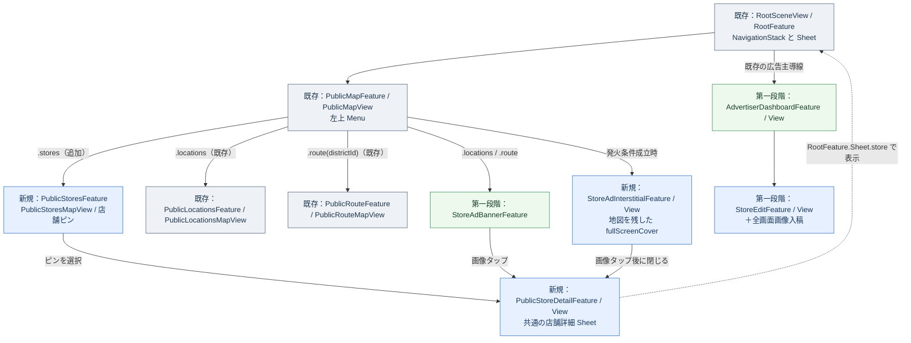
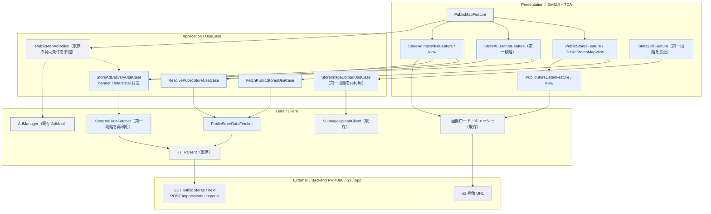
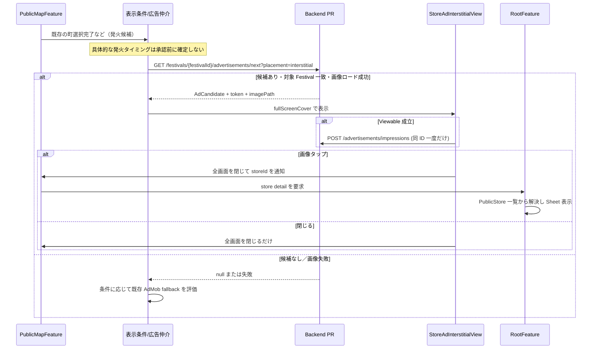
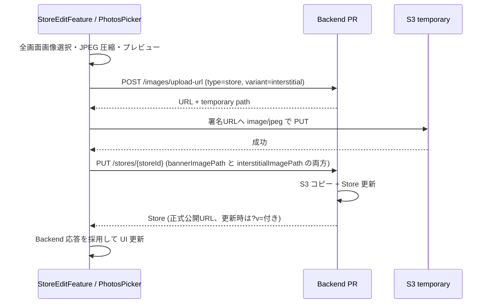

# MaTool 独自広告 iOS 設計 — 第二段階

- **状態**: 設計案（第二段階の実装前。未決定事項は明示する）
- **先行実装**: [第一段階の設計](./ios-phase1.md) — 広告主管理 Dashboard、店舗基本情報・バナー画像・Credit 購入、現在地一覧／各町の地図バナー
- **共通仕様**: [独自広告の基本仕様](./spec.md) / [Backend 設計](./backend.md) / [Backend PR #390](https://github.com/kmatsushita1012/MaTool/pull/390)
- **既存 iOS 参照コミット**: [`faf56f5`](https://github.com/kmatsushita1012/MaTool/commit/faf56f5662162cf8ffcfde23ce1a87a85be2f8c7)（第一段階設計の根拠と同じ。実装着手時に差分を再確認する）
- **本書の位置づけ**: 第一段階の実装を上書きせず、公開店舗地図・店舗詳細・独自全画面広告を**追加**する。既存の Festival／District 管理 UI は変更しない。

## 1. 第二段階のスコープと第一段階との差分

「**店舗モード**」は**来場者向けの公開地図**。広告主が自店舗を編集する `AdvertiserDashboard` / `StoreEditFeature` は第一段階のまま利用する。両者のデータと権限を混同しない。

| 項目 | 第二段階で行うこと | 第一段階からの扱い |
| --- | --- | --- |
| 地図モード | 左上の既存 `Menu` に**「店舗」**を追加、選択時は店舗専用地図に切り替え | `現在地一覧` / 各町を維持 |
| 店舗ピン | Festival 内の `PublicStore` を地図に表示、タップで店舗詳細へ | 町の山車／地点アノテーションを維持 |
| 一般向け店舗詳細 | 店名・住所・営業時間・説明・位置・公開画像を表示 | 新規。所有者向け編集 UI とは別 |
| バナータップ | 第一段階の**画像バナー**をタップすると同じ店舗詳細に遷移 | × の見た目・閉じる操作・固定位置は維持 |
| 全画面広告 | 独自の全画面画像、閉じる、表示実績送信、画像タップで店舗詳細へ | 新規。既存 AdMob と二重表示しない |
| 全画面画像入稿 | `StoreEditFeature` に**全画面画像の選択・プレビュー・削除**を追加 | 第一段階の純正 `Form`・保存処理を再利用 |
| AdMob フォールバック | 独自広告候補がない場合の配信制御（有効なら） | 第一点の暫定方針を統合する |
| 通報 | 店舗詳細などから広告通報を送信する最小 UI | SNS 通報通知は Backend 設定が必要 |
| 課金 | 地図ピン／店舗詳細は**ひとまず消費しない**。バナー1pt／全画面2pt | 従量課金は表示報告だけ。ピン課金は最終決定待ち |

### 守ること

1. 第一段階で確定した**地図下部バナーは、既存の右下操作ボタンより上に固定**。画像だけ＋右上の小さな ×。閉じた時も既存ボタンの位置は変えない。
2. 店舗モードにも**既存の地図上部 `Navigation Toolbar` / 左上の `Menu` を使う**。新しい `TabView`、下部タブバー、`segmented` Picker は作らない。
3. 現在地一覧と各町の既存 `MapView`、経路地点 Sheet、各町の日程 `Menu`、右下操作・リプレイ・Liquid Glass を維持する。
4. **店舗モードには独自バナーを置かない**。店舗モードは店舗ピンと詳細のための専用表示。
5. 公開店舗の取得は未認証でよいが、広告主の店舗管理／Credit／アップロード API を公開画面から呼ばない。
6. 広告主管理画面は引き続き純正 `Form` / `Section` / `PhotosPicker` 中心。全画面画像追加のためだけに独自の画面骨格を作らない。

## 2. 第二段階の画面ワイヤーフレーム

ここでの図は**配置と情報量を確定するための模式図**。色・装飾・数値は最終仕様ではない。既存 UI の部分は現行コードが正本。

### 2.1 地図「店舗」モード — `PublicStoresMapView`（新規）

```text
┌──────────────────────────────────────────┐
│ 掛川祭             ［祭紹介］［設定］     │ ← 既存 Navigation Toolbar
│                                          │
│ ［店舗 ▾］                               │ ← 既存左上 Menu に項目追加
│                                          │
│              MapKit 地図                  │
│                                          │
│           ● ○○商店                        │ ← 新規：店舗ピン
│                                          │
│                    ● △△カフェ             │ ← 新規：店舗ピン
│                                          │
│           ● □□食堂                        │
│                                          │
│                                ［⌖］     │ ← 新規画面のみの最小限の現在地操作（案）
└──────────────────────────────────────────┘
                   Bottom Safe Area
```

- `PublicMapFeature.Content` に `case stores` を追加。選択用 `Menu` の構成は**既存の `PublicMapContentView.topControls` を再利用**。
- 現行の `contents`（`[.locations] + routeDistrictIds`）は `[.stores, .locations] + routeDistrictIds` に拡張する**案**。表示順は**店舗 → 現在地一覧 → 各町**。既存モードは名前も機能も変えない。
- `selectedContent == .stores` のとき、右上の紹介ボタンは**祭紹介**とする案。現在地一覧は従来どおり祭紹介、各町は町紹介。町紹介を店舗モードに誤表示しない。
- 店舗モードの独立地図に、既存の地点・現在地一覧の山車マーカーやルートは混ぜない。**バナーも表示しない**。
- アノテーションのデザイン／密集時のクラスタリングは MapKit 標準の機能を優先し、不要なカスタムピン・ラベルは増やさない。
- 地図上の店舗を選択 → 対応する `PublicStore.ID` を使って店舗詳細を表示。Festival 変更後の古い店舗が残らないこと。

### 2.2 公開店舗詳細 — `PublicStoreDetailView`（新規）

```text
┌──────────────────────────────────────────┐
│                 ○○商店                   │
├──────────────────────────────────────────┤
│ ［店舗基本情報］                           │
│   住所            静岡県掛川市…           │
│   営業時間        10:00〜19:00            │
│                                          │
│ ［店舗紹介］                               │
│   お店の説明文…                           │
│                                          │
│ ［写真］                                   │
│   バナー画像または公開可能な店舗画像        │
│                                          │
│ ［位置］                                   │
│   地図で場所を確認                        │
│                                          │
│ ［その他］                                 │
│   この広告を通報                          │
└──────────────────────────────────────────┘
```

- 読み取り専用の `PublicStore` の**公開 DTO だけ**で表示。`ownerId`、`purchaseAccountToken`、残高、購入履歴、運営の内部停止理由は表示しない。
- 店舗詳細は**店舗ピン・バナー画像・全画面広告の3入口で共通**。同じ `PublicStoreDetailFeature` を使用する。
- `GET /stores/:storeId` は**広告主向け所有者 API**なので、公開店舗詳細に**使わない**。公開一覧 `GET /festivals/:festivalId/stores` から対象 ID を引き当てる。バナーから来た時に一覧未取得ならこの API を取得して解決する。
- 画像参照が `null` の場合は画像行を表示しない。画像の閲覧自体は Impression 報告・Credit 消費対象外。
- 通報は純正 `confirmationDialog`／`sheet` ＋入力フォーム。理由（1〜1,000文字）を入力し `POST /advertisements/reports`（`storeId`、任意 `placement`、`reason`）へ送る。SNS は広告配信の必須条件ではないが、**通報機能を公開する前には設定・受信を確認**する。
- 表示形式は**既存の紹介 Sheet と干渉しないシート**を基本案とする（`RootFeature.Sheet.store`）。戻り先の地図モード・地図領域を保つ。

### 2.3 全画面広告 — `StoreAdInterstitialView`（新規）

```text
┌──────────────────────────────────────────┐
│ 広告                               ［×］ │ ← 右上の閉じる操作
│                                          │
│                                          │
│        ┌──────────────────────┐          │
│        │                      │          │
│        │                      │          │
│        │  登録済み全画面画像    │          │ ← 画像の縦横比を維持
│        │                      │          │
│        │                      │          │
│        └──────────────────────┘          │
│                                          │
│                                          │
└──────────────────────────────────────────┘
             既存の地図の上に表示
```

- 全画面の表示は専用 `fullScreenCover`（または既存表現と整合する方式）に隔離し、**既存の地図／ナビゲーションを破棄しない**。画像の `scaledToFit` を基本とし、画像を無理に引き伸ばさない。
- 小さな広告識別表示と閉じる操作は必須案。× はすぐ押せ、VoiceOver と十分なタップ領域を確保する。自動で無限に再表示しない。
- 画像の**タップ** → 全画面を dismiss → **同じ `PublicStoreDetailView`** へ。× のタップでは詳細へ遷移しない。
- **広告画像のロード完了前／表示不可／他画面で覆われた状態**では表示報告しない。Viewable 成立時だけ `impressionId` と `impressionToken` を送る。
- タップで詳細に進んだ際も、**同じ表示に対し2回目の Impression を送らない**。全画面の単価は2pt。購入・閲覧を無料枠へ振り替える仕組みを作らない。
- 表示タイミングは**未確定**。後述の「判断待ち」に従い、承認までは新たな発火条件を固定しない。

### 2.4 広告主の店舗編集 — `StoreEditView` に行を追加（既存第一段階を拡張）

```text
┌──────────────────────────────────────────┐
│ ‹ 戻る                 店舗編集           │
├──────────────────────────────────────────┤
│ ［基本情報］ 店名／住所／営業時間／説明     │ ← 第一段階の Form
│ ［位置］ 地図で指定                        │ ← 第一段階
│                                          │
│ ［広告画像］                               │
│   バナー画像          ［写真を選択］       │ ← 第一段階
│   全画面画像          ［写真を選択］       │ ← 第二段階
│     ［選択画像プレビュー］                  │ ← 第二段階
│     ［画像を取り除く］                      │ ← 第二段階
│                                          │
│ ［配信設定］ 広告配信を一時停止  [Toggle]  │ ← 第一段階
│                                          │
│                 ［保存］                  │
└──────────────────────────────────────────┘
```

- 新しい画像保存 API や独立 `Advertisement` Entity を作らず、第一段階と**同じ Store PUT / 署名 URL**方式を使う。
- 全画面画像の `PhotosPicker` 選択・JPEG 化・ローカルプレビューは純正 UI を活用。**バナー画像のアップロードロジックを再利用**し、`variant=interstitial` を追加するだけにする。
- バナー／全画面の片方だけを更新した際、もう片方の公開画像 URL をそのまま維持して Store PUT。明示的に削除した場合のみ `null`。**両画像キーを必ず含める**。
- 「プレビュー」表示は広告配信ではなく、**Impression 報告しない**。正式 URL は Store PUT の**Backend 応答で置き換える**。

### 2.5 店舗詳細への入口の統一

| 入口 | 遷移先 | 注意 |
| --- | --- | --- |
| 店舗地図のピン | `PublicStoreDetailView(storeId:)` | `PublicStore` の一覧から ID 解決 |
| 現在地／各町の画像バナー | **同じ店舗詳細** | バナー右上の × とのタップ競合を防ぐ |
| 全画面広告画像 | 全画面を閉じて**同じ店舗詳細** | close と tap を別アクションとして扱う |

## 3. Navigation 構成図



### 3.1 `PublicMapFeature` の追加

```swift
enum Content: Equatable {
    case stores               // 第二段階で追加
    case locations            // 既存
    case route(District.ID)   // 既存
}

@Reducer
enum Destination {
    case stores(PublicStoresFeature)  // 第二段階で追加
    case locations(PublicLocationsFeature)
    case route(PublicRouteFeature)
}
```

- `State.contents` と `contentTitles`、`Content.id`、`Content.menuSymbol`、`onContentSelected` の switch をすべて更新する。
- `PublicMapView` の地図切替で `destination?.stores` を追加し、**既存の共通 `PublicMapContentView` を使って上部メニューを描画**。店舗モードでは日程 Menu は表示しない（`routes=nil`）。
- `RootFeature` の `.map(.delegate(.introductionTapped))` は `.stores` で Festival 紹介を出す。現在地一覧も Festival 紹介、各町は District 紹介を維持。
- `RootFeature.Sheet` に `.store(PublicStoreDetailFeature)` を追加する案。表示経路にかかわらず同一の Sheet を開き、Root が再フェッチ／ID 確認を担当する。
- 既存 `RootFeature.isAdminLoggedIn`、設定／管理者 push、Festival／District の紹介 Sheet と競合しないこと。
- 店舗地図で共有 `mapRegion` の変更が既存の現在地／各町の操作を壊さないこと。切り替え時の地図視点の扱いは `PublicMapFeature` 側で統一する。

## 4. TCA／UseCase／Data の相関図



**設計上の注意**

- **新規クラス名は提案**。第一段階で作った UseCase／Fetcher が同じ API と責務を持つなら、追加せずそこに処理を集約する。`.banner` と `.interstitial` に必要な差分だけ `StoreAdPlacement` で渡す。
- 新しい公開地図の正本は `AppState.festivalState.publicStores: [PublicStore]?`（未取得と空配列を区別）など、**Festival 単位のメモリ状態に保持**する案。Feature からは computed property で参照し、`AppState` 内部を直接 View に公開しない。
- 広告主の `Store`、`CreditAccount`、`PurchaseHistory` は**公開店舗データと混ぜない**。Backend の `PublicStore` に所有者限定属性が含まれないことを前提にする。
- Festival／セッションを切替時は現在の取得タスクをキャンセルし、`sessionId` を確認して古いレスポンスを反映しない。店舗タップも `storeId + festivalId` で一致を検証する。
- Store の表示・画像 URL は Backend 公開 DTO が正本。画像変更ごとに更新される `?v=` 付き URL を改変せず使用し、更新後の旧キャッシュを見せ続けない。
- **既存 `MapView` は `UIViewRepresentable` の `MKMapView` で、対応するアノテーションは地点／山車中心**。店舗ピンを描くために `StoreAnnotation` と delegate コールバックを追加するか、公開店舗専用 wrapper を作るか実装時に比較する。既存 `MapView` を拡張する場合も既存の `PointAnnotation`・`FloatAnnotation` に影響させない。**新たな全画面 Map を描き直す設計にはしない**。

## 5. 公開店舗一覧／ピン／詳細の通信

### 5.1 利用する Backend API

| API | 結果 | 第二段階の用途 |
| --- | --- | --- |
| `GET /festivals/:festivalId/stores` | `[PublicStore]` | 公開店舗ピン、詳細の表示、バナー／全画面からの ID 解決 |
| `GET /festivals/:festivalId/advertisements/next?placement=interstitial` | `AdCandidate?` | 全画面の画像・表示 token／impressionId |
| `POST /advertisements/impressions` | 成功空応答 | 全画面1表示2ptの確定。バナーは第一段階のまま1pt |
| `POST /advertisements/reports` | 成功空応答 | 店舗詳細からの通報（通知設定を事前確認） |
| `POST /images/upload-url` | `ImageUploadURLResponse` | 広告主の全画面画像、`target.variant=interstitial` |
| `PUT /stores/:storeId` | `Store` | バナーと全画面両フィールドを含む店舗情報の正式保存 |

**重要**: 公開店舗 ID の個別 GET API は現在の Backend PR #390 にない。所有者向け `GET /stores/:storeId` を未認証画面の代用にしない。公開一覧を取得して解決する。

### 5.2 公開店舗の取得・キャッシュ・状態更新

1. `.stores` を選んだら現在選択中の Festival ID に対して `GET /festivals/{festivalId}/stores` を呼ぶ。メモリ上に同じ Festival の新鮮な一覧がある場合は再利用できる。
2. 取得した `PublicStore` 一覧を Festival 単位の `AppState` に反映する。**空配列＝店舗なし、`nil`＝未取得**。
3. `PublicStoresMapView` は `coordinate` から店舗ピンを作成。店舗名等を表示できる場合は標準 `MKMarkerAnnotationView` に準拠。
4. ピン選択時は ID を Root に送り、最新の公開一覧から ID を解決して `PublicStoreDetailView` を表示する。
5. バナー／全画面タップの時点で一覧未取得なら公開一覧を取得し、`AdCandidate.storeId` で解決する。**現在の Festival と一致しない場合や店舗が停止・削除された場合は開かない**。
6. Festival 切替／ログアウト等の画面再生成時には古い店舗一覧と詳細 Sheet をクリアし、遅延応答を破棄する。
7. `PublicStore` の停止中は画像 URL が `null`、運営停止は一覧から除外、という Backend の公開制御を守る。**購入残高や広告主の編集権限を公開画面に持ち込まない**。

## 6. 全画面広告の配信・Impression／AdMob 連携

### 6.1 全画面表示シーケンス



### 6.2 表示条件の設計

- **共通方針**: `StoreAdPlacement.interstitial.creditCost == 2`、Store は Festival 内で運営停止・広告主停止なし、全画面画像あり、残高2pt以上。これは **Backend `next` が判断する**。iOS で任意の店舗を選択しない。
- **発火タイミングは未決定**。候補として、現在の `PublicMapAdPolicy.evaluate` が持つ**町の選択回数ベースの条件**を引き継ぐ方法がある。**新しい頻度・起動直後の表示・5秒ごとの表示**を勝手に加えない。
- 一回の発火で**独自全画面／AdMob 全画面のいずれか1つだけ**。画像ロード完了で独自広告を出し、その同じ発火で AdMob を出さない。独自広告が候補なし・ロード失敗なら **AdMob が設定済みかつ有効な場合だけ** fallback を検討する。
- 現行 `PublicMapAdUsecase` は `AdManager.presentInterstitial` を直接呼ぶため、そのまま新規ロジックを足すと**二重表示**する。`PublicMapAdPolicy` の発火判定と広告配信手段の選択を分けて制御する。既存の閲覧ルール・猶予回数・管理者除外を後退させない。
- 現行 `AdManager.isAdvertisementEnabled = false`。このフラグを変えずに「AdMob が常にフォールバックする」とは言えない。**配信開始前に AdMob の運用可否を別途決定する**。独自広告がない場合に AdMob が無効なら何も出さない。
- 全画面のダウンロード完了前に地図操作が進んだ／Festival が変わった／アプリが背景になったときは発火を破棄する。**古い広告を別祭典に表示しない**。
- 広告を閉じた後に自動ループ再表示しない。案内 Sheet や既存 Route の操作と同時に覆い被せない。
- Viewable は**ユーザーの目に実表示された条件**であって `next` を取得しただけでは成立しない。閾値は事前決定する。閉じる／すぐ背景化／画像ロード失敗の時は条件未達なら報告しない。
- `POST /advertisements/impressions` は1 `impressionId` につき1回の送信（Backend 側も二重課金防止）。応答未着は**端末にためて後日請求しない**。ネットワーク失敗で表示報告が成立しない場合は消費されない。
- 全画面広告自体の**プレビュー**は広告主 `StoreEditView` からアクセスできるが、`next` / `impressions` は呼ばず課金しない。

### 6.3 店舗広告バナーの第二段階拡張

第一段階の `StoreAdBannerFeature`、画像だけのバナー、右上小さな閉じる ×、5秒で非表示、位置・Viewable 送信制御は維持。

第二段階で変更するのは**画像タップで `storeId` を Root に送る処理だけ**。`×` は独立したボタンでタップイベントを透過・誤伝播させない。タップで店舗詳細へ遷移するときはタイマーを停止し、広告表示条件の成立／未成立に応じて同じ `impressionId` を二重送信しない。

**店舗モードにはこのバナーを追加しない。** 公開店舗一覧を地図に表示しても Credit は減らさない。

## 7. 広告主の全画面画像入稿



- 固定 S3 一時キー: `temporary/stores/{storeId}/interstitial.jpg`。正式配置: `stores/{storeId}/interstitial.jpg`（Backend に従う）。個別画像 UUID／ETag／独立 confirm API は追加しない。
- バナーと全画面の片方だけを変更したとき、**変えていない方のパスを保持**する。削除は明示 `null`、物理削除は行わない。
- 画像保存直後に `StoreEditView` の状態を更新するのではなく、**PUT 成功後の Store を正本**にする。通信失敗時は保存未完了として再試行可能にする。
- `ownerPaused` と運営の `moderationStatus` は別。運営停止中に画像・広告を公開再開できるとみなさない。
- 店舗編集は第一段階から引き続き**純正 Form / Section / PhotosPicker** 中心で、全画面用の独立した特殊画面を作らない。

## 8. 受入シナリオ（第二段階）

| ID | 手順 | 期待結果 |
| --- | --- | --- |
| P2-01 | 地図左上の `Menu` を開く | `店舗 → 現在地一覧 → 各町` が表示され、既存の選択操作は変わらない |
| P2-02 | 「店舗」へ切替 | 店舗専用地図で公開店舗ピンを表示。独自バナー／町の日程 Menu は出ない |
| P2-03 | 店舗ピンを押す | 該当店舗の詳細 Sheet。所有者・Credit など非公開情報はない |
| P2-04 | 店舗ピンから詳細を閉じる | 同じ店舗地図・同じ選択 Festival に戻る |
| P2-05 | 現在地一覧／各町に戻る | 既存 Toolbar・日程・右下操作群・地点 Sheet・リプレイがそのまま動く |
| P2-06 | 地図下部のバナー画像を押す | Store ID を公開一覧から解決し、店舗ピンと**同じ**詳細 Sheet を開く |
| P2-07 | バナー右上 × を押す | **閉じるだけ**で詳細は開かない。既存右下ボタンは動かない |
| P2-08 | バナー表示直後に Festival を切替 | 古い候補・古い店舗詳細を表示せず、旧 Festival の情報を持ち越さない |
| P2-09 | 公開停止中／削除された店舗を取得 | PublicStore 一覧から除外（運営停止）または画像パス非公開（所有者停止）を守る |
| P2-10 | 全画面広告の発火時に候補あり | 画像ロード後に専用 fullScreenCover を1回表示。既存 AdMob と二重表示しない |
| P2-11 | 全画面画像をタップ | 広告を閉じて同一店舗詳細へ。× の場合は詳細を開かない |
| P2-12 | 全画面の画像ロード失敗／即閉じ／背景化 | Viewable 閾値未達なら Impression は送信しない |
| P2-13 | Viewable 成立し、同じ token を再通知 | 1回の表示に対して**2ptを一度だけ消費**、二重送信・二重課金がない |
| P2-14 | 全画面候補なし | 設定どおり AdMob fallback（有効な場合のみ）または非表示。二重表示しない |
| P2-15 | 広告主が全画面画像だけ入稿 | `interstitialImagePath` は更新、`bannerImagePath` は維持、公開 URL は更新版 |
| P2-16 | 全画面画像を取り除く | `interstitialImagePath=null`。バナー画像は変えず全画面候補から除外 |
| P2-17 | 店舗詳細から広告を通報 | 理由1〜1,000文字を送信し、Backend 応答・SNS メール受信を確認 |
| P2-18 | 町の地点 Sheet と広告表示が競合 | 地図の既存操作・Sheet を妨げず、広告の表示順序を制御 |
| P2-19 | 祭典変更中に店舗一覧レスポンスが遅延 | 古い Festival の `PublicStore` を新しい `AppState` へ書き込まない |
| P2-20 | 権限のない閲覧者が店舗詳細を開く | 公開 API だけで取得でき、所有者向け `GET /stores/:id` は呼ばない |

**テスト実装**: `import Testing` の Reducer テストで `Content.stores`、モード切替、Sheet、広告キャンセル／二重報告、全画面の発火条件、AdMob 選択、Festival 切替競合を検証。`Tests/Utility/` に Spy を置き、Backend の公開 API／画像署名 URL の結合テストは別途実施。iOS 実装後は Simulator で **LocationsMap、RouteMap、StoresMap、店詳細、全画面**を実際に操作しスクリーンショットで確認する。

## 9. 第二段階の着手前に決めること

以下は元の仕様でも**未確定**。MVP 実装前に判断する。暫定案を確定済み仕様として扱わない。

| 項目 | 推奨案／確認点 | 決定されるまで |
| --- | --- | --- |
| 全画面広告の発火 | 既存 `PublicMapAdPolicy` の町選択タイミングを参考にする。発火頻度、猶予、管理者除外を定義 | 新規のタイミングを勝手に実装しない |
| 全画面 UI の閉じ方 | 画像右上に ×、即時閉じられる | UI テスト仕様を確定 |
| Viewable の成立条件 | 可視割合・時間・前面表示・重複送信の扱い | Backend 課金に接続する前に確定 |
| 店舗ピン閲覧・詳細の課金 | **現時点の設計案は消費なし**。課金対象はバナー／全画面のみ | 今後変更するなら Backend と同時改定 |
| 全画面画像の仕様 | JPEG 画素数・容量・縦横比・`scaledToFit` の余白 | UI と Backend 検証条件を一致させる |
| 店舗モードの初期中心 | Festival 中心を基本案とし、地図モードごとの位置復元を検討 | 既存 `mapRegion` 動作を壊さない方式を選ぶ |
| AdMob fallback | 既存 `isAdvertisementEnabled=false` と AdMob 入稿／規約／配置を確認 | 「候補なしなら必ず出る」と約束しない |
| 画像タップ・店舗詳細 | Sheet の `presentationDetents`、閉じてから次 Sheet 表示の順序 | 既存紹介 Sheet と競合しない形で確定 |
| 通報 | SNS 通知先の運用設定、理由入力の UX、通信失敗時のフィードバック | 公開前に通報の受信確認 |

## 10. ソース照合先と引き継ぎ

| 範囲 | 参照元 |
| --- | --- |
| 第一段階の詳細設計 | [`ios-phase1.md`](./ios-phase1.md) |
| 製品仕様・公開 DTO と料金 | [`spec.md`](./spec.md) |
| 現行モード／TCA Destination | [`PublicMapFeature.swift`](../../../iOSApp/Sources/Presentation/View/Public/Map/Root/PublicMapFeature.swift) |
| 上部地図 Menu・Toolbar | [`PublicMapView.swift`](../../../iOSApp/Sources/Presentation/View/Public/Map/Root/PublicMapView.swift) |
| 公開店舗用の MapKit 拡張候補 | [`MapView.swift`](../../../iOSApp/Sources/Presentation/Parts/Map/MapView.swift) |
| 現在地一覧右下操作 | [`PublicLocationsMapView.swift`](../../../iOSApp/Sources/Presentation/View/Public/Map/Locations/PublicLocationsMapView.swift) |
| 各町右下操作・リプレイ | [`PublicRouteMapView.swift`](../../../iOSApp/Sources/Presentation/View/Public/Map/Route/PublicRouteMapView.swift) |
| 既存 AdMob の表示条件 | [`PublicMapAdUsecase.swift`](../../../iOSApp/Sources/Application/PublicMapAdUsecase.swift) |
| 既存 AdMob の有効／無効 | [`AdManager.swift`](../../../iOSApp/Sources/Data/Client/AdManager.swift) |
| Backend 店舗 API | [`StoreController.swift`](https://github.com/kmatsushita1012/MaTool/blob/backend/original-advertisement/Backend/Sources/Controller/StoreController.swift) |
| Backend 広告 API | [`AdvertisementController.swift`](https://github.com/kmatsushita1012/MaTool/blob/backend/original-advertisement/Backend/Sources/Controller/AdvertisementController.swift) |
| Shared DTO | [`AdvertisementDTO.swift`](https://github.com/kmatsushita1012/MaTool/blob/backend/original-advertisement/Shared/Sources/DTO/AdvertisementDTO.swift) |

---

**このファイルは第二段階の設計のみ。** 第一段階の `AdvertiserDashboard`／Credit／バナー配置を重複実装せず、既存 Swift ソースへの修正はこの PR に含めない。設計レビューで未確定点を決めた後、実装 PR を切る。
