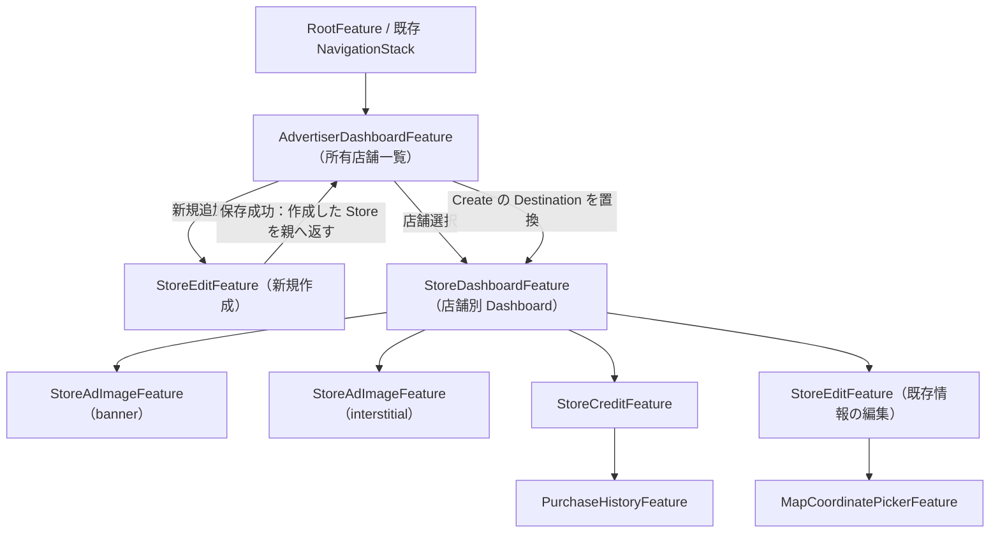

# 広告主の店舗別 Dashboard UX — B案採用

- **状態**: 実装前の UX 設計
- **プレビュー**: [操作可能 HTML（B案のみ）](./mockups/store-dashboard-b.html)
- **関連**: [iOS 第一段階](./ios-phase1.md) / [iOS 第二段階](./ios-phase2.md) / [iOS 実装 PR #410](https://github.com/kmatsushita1012/MaTool/pull/410)
- **このPRの変更範囲**: 設計書と HTML モックのみ。Swift 実装は変更しない

## 1. 画面構成

店舗を選択して直接「店舗編集」を開く現行の導線を廃止し、**店舗一覧 → 店舗別 Dashboard → 目的別画面**に改める。

| 画面 | 主な操作 | 別画面へ移す操作 |
| --- | --- | --- |
| `AdvertiserDashboard`（既存の所有店舗一覧） | 店舗選択・追加、アカウント | 店舗の編集は直接開かない |
| **`StoreDashboard`（B案）** | 必要な次の設定への案内、バナー広告、全画面広告、残高・購入、基本情報編集、**広告配信の一時停止** | 配信状態専用ボタン・購入履歴・位置編集の直リンクは置かない |
| バナー広告 | 画像の選択・差し替え・削除 | 一時停止 Toggle は置かない |
| 全画面広告 | 画像の選択・差し替え・削除 | 一時停止 Toggle は置かない |
| 残高・購入 | Credit 残高、商品購入 | **購入履歴はこの画面からのみ** |
| 基本情報を編集 | 店舗名・住所・営業時間・説明 | **位置編集はこの画面からのみ** |
| 店舗を追加 | 新規店舗の登録 | **保存成功後は作成した店舗の Dashboard へ** |

## 2. B案の上部案内：次の操作カード

上部案内は**未設定項目があるときだけ表示する、1枚のタップ可能なボタン**とする。冗長なセカンダリテキスト、黄色の「画像未設定」ラベル、詳細状況の段落、重複した CTA は置かない。カードをタップすると次のアクション画面へ直接 push する。

優先順位は次のとおり。**同時に複数の案内カードを出さない**。

| 優先 | 条件 | 表示文言 | 遷移 |
| --- | --- | --- | --- |
| 1 | バナー画像未登録 | **バナー画像を設定** | バナー広告 |
| 2 | バナー登録済み・全画面画像未登録 | **全画面画像を設定** | 全画面広告 |
| 3 | 両画像登録済み・残高が2pt未満 | **クレジットを購入** | 残高・購入 |
| 完了 | 両画像登録済み・残高2pt以上 | **案内全体を消す** | — |

- **画像選択中ではなく、Backend に保存済みの画像パス**を登録済み判定に使う。購入画面を開いただけで残高が増えた扱いにしない。
- **ロード中・取得失敗時は「未設定」「0pt」と誤認しない**。状態が確定するまで案内を出さず、既存のエラー処理／再試行へ。
- 「店舗が公開中」と「広告配信可能」は別の意味。`ownerPaused` は任意の配信停止状態であり、画像や残高の設定完了とは独立させる。
- 全画面画像は後続実装の機能だが、モックは完成形の UX を描く。画面にはリリース段階等の内部用語を書かない。

## 3. Navigation Tree

### 3.1 Reducer での操作

1. `AdvertiserDashboardFeature.Destination` に **`storeCreate(StoreEditFeature)` と `storeDashboard(StoreDashboardFeature)`** を追加する。既存の Festival/District Dashboard と同様、`@Presents`・`navigationDestination` に沿って構成する。別の `NavigationStack` を作らない。
2. **既存店舗の選択**: `storeTapped` は `.storeDashboard(StoreDashboardFeature.State(store: ...))` に遷移し、`StoreEditFeature` を直接開かない。
3. **新規作成の保存**: `StoreEditFeature` は Backend 保存成功時に `.delegate(.created(store))` で作成済みの Store を親へ通知。親は `stores.upsert(store)` を実行し、`destination = .storeDashboard(...)` **へ置き換える**。古い作成画面を残さない。戻ると「店舗管理」一覧。
4. **既存情報の編集**: `StoreDashboardFeature.Destination.storeEdit` を push。保存成功時に `.delegate(.updated(store))` で Backend の保存済み Store を反映し、編集画面を閉じて**店舗別 Dashboard に戻る**。所有店舗一覧も更新する。
5. バナー画像／全画面画像管理、残高・購入は `StoreDashboardFeature` の子。購入履歴は `StoreCreditFeature` の子、位置は `StoreEditFeature` の子。Dashboard に重複導線を追加しない。
6. 新規作成／編集の**保存失敗時は元画面に残る**。結果を受け取っていないのに Dashboard に遷移しない。
7. Root／認証復元／ログアウトのツリー構築は既存の `FestivalDashboard`／`DistrictDashboard` と同じ方針を維持。ログアウト時は Dashboard の子画面も全破棄する。

### 3.2 状態の正本

- `StoreDashboardFeature.State` は Store と残高の Backend 応答を保持し、上部案内の表示先を**computed property で1つ導出**する。`showBannerSetupPrompt` 等の重複 Boolean を State に持たない。
- バナー／全画面の入稿後・Credit の購入後に最新の値を反映し、案内を再計算。両画像と残高が揃ったら案内領域ごと消す。
- 配信一時停止は Dashboard の Toggle だけで変更。API 失敗時は値を戻す。画像画面や基本情報の編集画面から二重に操作させない。

## 4. 純正カラーと文言

実装では `UIColor.systemGroupedBackground`（背景）、`secondarySystemGroupedBackground`（グループ面）、`label`・`secondaryLabel`（文字）、`separator`、`systemBlue`、`systemRed` を使い、ライト／ダーク・Dynamic Type・VoiceOver に追従する。独自 UI は上部の**次の操作カード**だけを基本とし、その他は `Form`／`List`／`Section`／`Button`／`Toggle` を使う。

HTML は UIKit を呼べないため、上記 UIColor に近い CSS 変数で近似する。**UIモック内に開発用語（`第二段階`、`S3`、`API`、`デモ`、`モック`）や余計な補足を表示しない**。各画面の名前と操作に必要な短い文言だけにする。

## 5. 受入条件

- [ ] 既存店舗選択 → **店舗別 Dashboard**。直接店舗編集に入らない。
- [ ] 店舗を追加 → 保存成功 → **新しい店舗の Dashboard**。戻ると所有店舗一覧。保存失敗ならフォームに残る。
- [ ] 上部案内が「バナー画像を設定」の場合、**カード全体**でバナー画面に進む。
- [ ] バナー設定後、全画面未設定なら「全画面画像を設定」に切り替わり、同様に遷移する。
- [ ] 両画像設定後、残高不足なら「クレジットを購入」から残高・購入へ進む。
- [ ] 両画像＋残高2pt以上 → **上部案内が消える（余白もなし）**。
- [ ] 一時停止は Dashboard にしかない。購入履歴は残高・購入の子、位置編集は基本情報編集の子。
- [ ] 既存情報の保存後は店舗別 Dashboard に戻り、Backend の戻り値を反映する。
- [ ] モック上に内部用語・無駄な補足や二重ボタンがない。
- [ ] 既存の Festival/District Dashboard と Root Navigation／ログアウトの挙動を壊さない。

**実装対象の参考**: [PR #410](https://github.com/kmatsushita1012/MaTool/pull/410) の `AdvertiserDashboardFeature/View`、`StoreEditFeature/View`、`StoreCreditFeature/View`。
